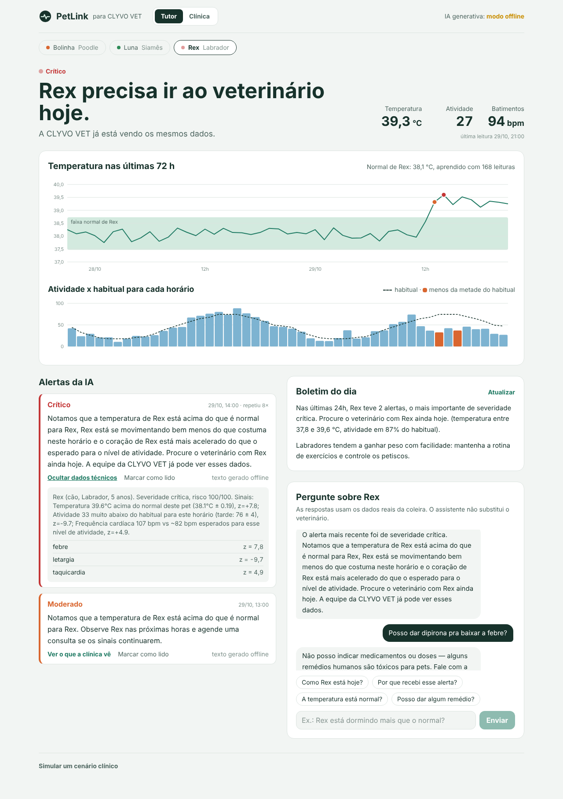
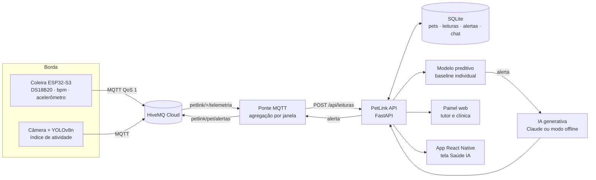

# PetLink · IA integrada à CLYVO VET — Sprint 4

**Disruptive Architectures: IoT, IoB & Generative IA — FIAP · Challenge CLYVO VET**

| Integrante | RM |
|---|---|
| Felipe Furlanetto | 562766 |
| Raul Rezende | 564002 |
| João Victor Caetano | 562074 |
| Ryan Victor | 565667 |
| João Victor Castelini | 564115 |

🎥 **Vídeo pitch (YouTube, não listado):** _cole o link aqui_
📦 **Repositório:** https://github.com/Buenozw/CHALLENGE---IOT



---

## O que esta entrega faz

Na Sprint 3 definimos o componente de IA do PetLink: um modelo que aprende o **normal de cada pet** e avisa quando ele sai desse normal. Nesta sprint ele foi **implementado, melhorado, integrado e validado**:

1. A coleira (ESP32-S3) publica temperatura, atividade e batimentos via **MQTT**.
2. A **ponte MQTT** entrega cada leitura à **API FastAPI**, que valida, grava no **SQLite** e roda o **modelo preditivo**.
3. Se houver anomalia, a **IA generativa (Claude)** escreve duas explicações: uma simples para o **tutor** e um resumo técnico para a **clínica**.
4. O tutor acompanha tudo no **painel web** ou na **tela do app** (React Native) e pode **conversar com um assistente** que responde com base nos dados reais do pet.
5. A CLYVO VET vê uma **fila de triagem** ordenada pelo risco calculado pela IA.

Tudo funciona sem internet e sem chave de API (o assistente cai num modo offline por templates), o que deixa a demonstração reproduzível em qualquer máquina.

## Como cada objetivo da Sprint 4 foi atendido

| Objetivo / tarefa do enunciado | Onde está |
|---|---|
| Implementar a solução de IA definida na entrega anterior | [`ia/anomaly_detector.py`](ia/anomaly_detector.py) — evolução do modelo da Sprint 3 (8 melhorias listadas no topo do arquivo) |
| IA generativa / agente conversacional | [`ia/assistente_ia.py`](ia/assistente_ia.py) — explicação de alertas, boletim diário e chat com guardrails |
| Preparar e organizar os dados, com testes e validação | [`simulador/modelo_fisiologico.py`](simulador/modelo_fisiologico.py), `validar_leitura()` no detector, [`dados/`](dados/) (datasets rotulados) |
| Integração entre aplicação, banco, APIs e IA | [`api/`](api/) (FastAPI + SQLite), [`mqtt_bridge/`](mqtt_bridge/) (HiveMQ ↔ API) |
| IA integrada e transparente ao usuário | O tutor nunca "chama a IA": cada leitura passa pelo modelo sozinha e o resultado aparece como frase simples no [painel](web/) e na [tela do app](mobile/screens/SaudeIAScreen.js) |
| Testar e validar em cenários reais de uso | [`tests/`](tests/) — 53 testes, incluindo [`test_cenarios_reais.py`](tests/test_cenarios_reais.py) ponta a ponta |
| Avaliar resultados e personalização | [`docs/RESULTADOS.md`](docs/RESULTADOS.md) — comparação com limiar fixo e com o modelo da Sprint 3 |
| Evidências (telas, fluxos, relatórios, demonstração) | Painel com simulador de cenários, prints em [`docs/img/`](docs/img/), [`docs/ROTEIRO_VIDEO.md`](docs/ROTEIRO_VIDEO.md) |

## Arquitetura



Detalhes de cada camada, decisões de projeto e formato dos dados: [`docs/ARQUITETURA.md`](docs/ARQUITETURA.md).

## Como rodar

Requisitos: **Python 3.10+**.

```bash
pip install -r requirements.txt
python -m uvicorn api.main:app --reload
```

Abra **http://localhost:8000** (painel) ou **http://localhost:8000/docs** (Swagger). Na primeira execução o banco é criado com os 3 pets (Rex, Luna e Bolinha) e 7 dias de histórico normal, então o baseline já está pronto.

**Demonstração:** no fim da página do tutor, abra "Simular um cenário clínico" e escolha, por exemplo, *Febre com prostração*. Cada leitura simulada representa 1 hora e passa pelo mesmo caminho de uma leitura real. Em "Restaurar dados iniciais" o banco volta ao estado de partida.

**IA generativa com o Claude (opcional):** copie `.env.example` para `.env` e preencha `ANTHROPIC_API_KEY`. O cabeçalho do painel mostra "IA generativa: conectada". Sem a chave, aparece "modo offline" e tudo continua funcionando.

**Com a coleira / Wokwi (MQTT):**

```bash
# terminal 1 — API
python -m uvicorn api.main:app
# terminal 2 — ponte MQTT (use as credenciais do HiveMQ Cloud no .env)
python -m mqtt_bridge.ponte_mqtt
# terminal 3 — sem o ESP32 em mãos, simule a coleira publicando
python -m simulador.publicar_mqtt --pet rex --cenario febre --intervalo 2
```

O firmware deve publicar em `petlink/<pet_id>/telemetria` um JSON como `{"temperatura": 38.4, "atividade": 55, "bpm": 92}` (nomes em inglês também são aceitos: `temperature`, `activity`, `heart_rate`).

**App mobile:** copie [`mobile/services/petlinkApi.js`](mobile/services/petlinkApi.js) e [`mobile/screens/SaudeIAScreen.js`](mobile/screens/SaudeIAScreen.js) para o projeto Expo, registre a tela no navegador (instruções no topo do arquivo) e aponte `API_URL` para o IP do computador que roda a API.

**Testes e avaliação:**

```bash
python -m pytest -q                    # 53 testes (~6 s)
python -m avaliacao.avaliar_modelo     # regenera docs/RESULTADOS.md, gráficos e datasets (~2-3 min)
```

## Principais endpoints

| Método | Rota | O que faz |
|---|---|---|
| `POST` | `/api/leituras` | Recebe uma leitura (ESP32, ponte MQTT ou app) e devolve o alerta, se houver |
| `GET` | `/api/pets/{id}` | Status atual, última leitura, baseline aprendido e contexto das últimas 24 h |
| `GET` | `/api/pets/{id}/alertas` | Alertas com explicação para o tutor e resumo clínico |
| `GET` | `/api/pets/{id}/resumo` | Boletim do dia gerado por IA, personalizado por espécie, raça e idade |
| `POST` | `/api/pets/{id}/chat` | Assistente conversacional com base nos dados do pet |
| `GET` | `/api/clinica/triagem` | Fila de prioridade da CLYVO VET ordenada pelo risco |
| `POST` | `/api/demo/cenario` | Injeta um cenário clínico simulado (febre, letargia, hipotermia…) |

## O modelo de IA em uma página

O PetLink não usa "febre se temperatura > 39,2 °C". Ele aprende, com 7 dias de dados, o normal **daquele** pet e mede o quanto cada leitura se afasta dele.

| Técnica | Por quê |
|---|---|
| **Baseline robusto** (mediana + MAD) por pet | Um episódio antigo de febre não "estraga" a referência |
| **Leitura atual fora do próprio baseline** | Corrige um defeito da Sprint 3, em que o valor avaliado diluía o próprio z-score |
| **Atividade comparada com o mesmo horário** (±1 h) | Dormir de madrugada não é letargia; ficar parado às 15 h pode ser |
| **Batimentos ajustados pela atividade** (regressão linear por pet) | Coração acelerado correndo é normal; em repouso, não |
| **Persistência** | Desvio fraco precisa aparecer em 2 leituras seguidas; desvio forte alerta na hora |
| **Tendência em curso** (24 h e 6 h vs. dias anteriores) | Pega pioras lentas antes de virarem crise — é a parte preditiva |
| **Regras clínicas de segurança** | ≥ 40,5 °C ou ≤ 36,5 °C é crítico, com ou sem baseline |
| **Validação do sensor** | Leitura impossível é descartada; temperatura ambiente indica coleira fora do pet |

A camada generativa recebe a decisão pronta e só escreve. Ela **não decide** se há anomalia, **não diagnostica**, **não indica remédio**, e mensagens com palavras de emergência ("convulsão", "envenenamento"…) sempre recebem uma orientação fixa de atendimento imediato antes de qualquer texto gerado.

## Resultados

Avaliação em séries sintéticas rotuladas (3 pets × 90 dias, episódios clínicos injetados). O limiar foi escolhido no conjunto de **validação**; os números abaixo são do conjunto de **teste**.

| | Limiar fixo | Modelo Sprint 3 | **Modelo Sprint 4** |
|---|---|---|---|
| Episódios detectados | 75% | 69% | **94%** |
| Falsos alarmes por pet por semana | 4,99 | 1,07 | **0,03** |
| Latência mediana até o 1º alerta | 1 h | 1 h | 2 h |
| F1 por leitura | 0,41 | 0,47 | **0,61** |


O modelo da Sprint 3 não detectou nenhuma hipotermia (só olhava a temperatura para cima) nem nenhuma letargia sem febre (a atividade era comparada com a média do dia inteiro, então a variação normal entre dia e noite escondia a queda); o limiar fixo dispara cerca de 9 alarmes falsos por semana na Bolinha, cujo normal é perto de 39 °C, e detectou só 1 das 5 febres discretas do Rex, cujo normal é 38,1 °C. O preço da confirmação em duas leituras é cerca de 1 hora a mais de latência em desvios fracos — desvios fortes continuam alertando na hora. Relatório completo, por tipo de episódio e por pet: [`docs/RESULTADOS.md`](docs/RESULTADOS.md).

## Estrutura do repositório

```
ia/                 modelo preditivo (anomaly_detector.py) e IA generativa (assistente_ia.py)
api/                FastAPI: rotas, pipeline de ingestão (servico.py), banco SQLite, schemas
mqtt_bridge/        ponte HiveMQ ↔ API, com agregação por janela
simulador/          modelo fisiológico dos pets, seed do banco, publicador MQTT
web/                painel do tutor e da clínica (React + Tailwind, sem build; libs em web/vendor)
mobile/             tela Saúde (IA) e cliente da API para o app Expo
tests/              53 testes: detector, API, IA generativa, MQTT e cenários reais
avaliacao/          avaliação comparativa + cópia congelada do modelo da Sprint 3
dados/              datasets rotulados gerados pela avaliação (validação e teste)
docs/               arquitetura, resultados, roteiro do vídeo e imagens
```

## Tecnologias

Python 3 · FastAPI · Pydantic · SQLite · paho-mqtt · HiveMQ Cloud · Anthropic Claude (SDK oficial) · React 18 · Tailwind CSS 4 · React Native (Expo) · pytest · matplotlib · ESP32-S3 / Wokwi · YOLOv8n + OpenCV (módulo de visão das sprints anteriores)

## Limitações e próximos passos

- Os dados de avaliação são **sintéticos**; o próximo passo é coletar dados reais com a CLYVO VET e recalibrar os limiares.
- A temperatura da coleira é de superfície; ela precisa ser calibrada contra a temperatura retal medida na clínica.
- Com uma base real maior, testar Isolation Forest ou um modelo sequencial e comparar com o baseline estatístico atual usando o mesmo protocolo de [`avaliacao/`](avaliacao/).
- Autenticação de tutores e veterinários na API (hoje a API é aberta para facilitar a demonstração).
