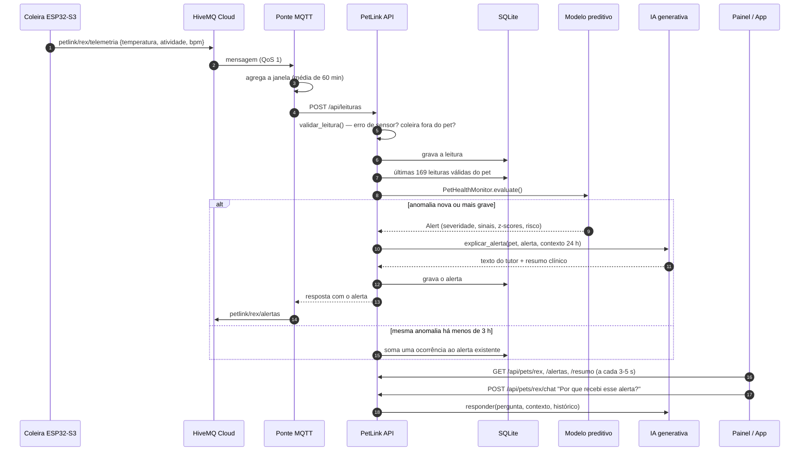
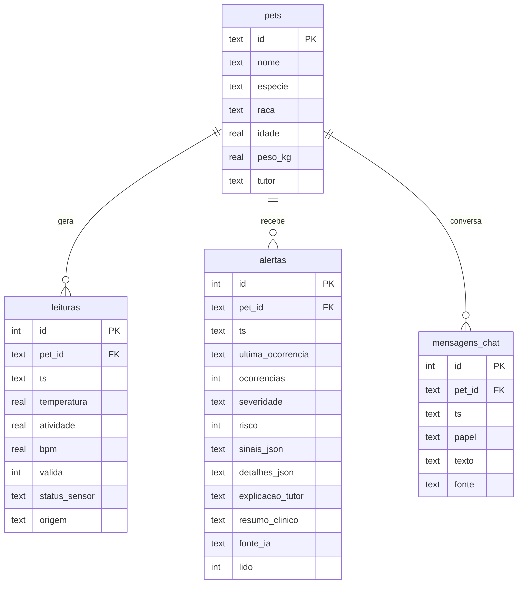

# Arquitetura e documentação técnica — PetLink Sprint 4

## 1. Visão geral

| Camada | Arquivo | Responsabilidade |
|---|---|---|
| Borda | firmware ESP32 (sprints 1–2), `simulador/publicar_mqtt.py` | Coleta e publica telemetria |
| Mensageria | `mqtt_bridge/ponte_mqtt.py` | Assina `petlink/+/telemetria`, agrega, chama a API e republica alertas |
| API | `api/main.py`, `api/schemas.py` | Contrato REST, validação de entrada (Pydantic), CORS para o app |
| Orquestração | `api/servico.py` | Pipeline leitura → modelo → IA generativa → banco → notificação |
| Persistência | `api/database.py` | SQLite com 4 tabelas (abaixo) |
| IA preditiva | `ia/anomaly_detector.py` | Decide se há anomalia e quão grave |
| IA generativa | `ia/assistente_ia.py` | Transforma a decisão em linguagem para tutor e clínica; chat |
| Interfaces | `web/app.jsx`, `mobile/screens/SaudeIAScreen.js` | Painel tutor/clínica e tela do app |

## 2. Modelo de dados

- Leituras inválidas **são gravadas** (`valida = 0`, com o motivo em `status_sensor`) para auditoria, mas nunca entram no baseline.
- `ocorrencias` e `ultima_ocorrencia` implementam o anti-spam: 10 horas de febre geram 1–2 notificações, não 10.
- `fonte_ia` registra se o texto veio do LLM ou do modo offline — transparência para quem lê o alerta.

## 3. Preparação e validação dos dados

| Etapa | Onde | Regra |
|---|---|---|
| Esquema | `api/schemas.py` | Tipos e faixas; aceita nomes em português e inglês (payload do ESP32) |
| Plausibilidade física | `validar_leitura()` | Temperatura fora de 25–45 °C ou atividade fora de 0–100 → `erro_sensor` |
| Coleira fora do pet | `validar_leitura()` | Temperatura < 35 °C → `coleira_fora_do_pet` (evita falsa hipotermia) |
| Batimento impossível | `validar_leitura()` | bpm fora de 20–320 é ignorado sem descartar o resto da leitura |
| Agregação | `ponte_mqtt.Agregador` | O modelo trabalha com 1 ponto por hora; a ponte envia a média da janela |
| Fuso | `servico._normalizar_ts()` | Tudo em America/Sao_Paulo (UTC−3) para o perfil circadiano funcionar |
| Dados de avaliação | `simulador/modelo_fisiologico.py` | Séries horárias com ritmo circadiano, bpm correlacionado à atividade e episódios rotulados |

## 4. Modelo preditivo

Para cada nova leitura `x` do pet `p`, usando as 168 leituras anteriores (7 dias):

- **Temperatura:** `z = (x − mediana) / (1,4826 · MAD)`, com piso de 0,12 °C no denominador.
- **Atividade:** mesma fórmula, mas a referência são só as leituras da **mesma faixa horária (±1 h)** nos dias anteriores.
- **Batimentos:** regressão `bpm ≈ a + b · atividade` ajustada no histórico do pet; o z-score é calculado sobre o **resíduo**.
- **Limiar:** |z| ≥ 3,0 (escolhido no conjunto de validação, ver `docs/RESULTADOS.md`). |z| ≥ 4,5 conta peso 2.
- **Persistência:** sinal de peso 1 só conta se o mesmo tipo de sinal apareceu na leitura anterior.
- **Tendência:** atividade média < 70% do habitual **e** temperatura mediana ≥ +0,45 °C são verificadas nas últimas 24 h e nas últimas 6 h (a tendência precisa estar em curso).
- **Regras clínicas:** ≥ 40,5 °C ou ≤ 36,5 °C → crítico, independentemente do baseline.
- **Cold start** (< 24 leituras): faixas de referência por espécie.

**Severidade:** soma dos pesos → 1 = leve, 2 = moderada, ≥ 3 ou regra clínica = crítica. **Risco (0–100)** = 25 × pesos (+30 com regra clínica), limitado a 100; é o que ordena a triagem da clínica.

### Por que não um modelo de deep learning?

O problema tem pouco dado por pet (dias, não anos), precisa funcionar desde a primeira semana e precisa ser **explicável** para o veterinário ("39,6 °C, z = +7,8 em relação ao normal do Rex"). Um baseline estatístico robusto atende os três requisitos, roda em milissegundos e serve de linha de base para comparar modelos mais complexos quando houver dados reais.

## 5. IA generativa

| Funcionalidade | Entrada | Saída | Público |
|---|---|---|---|
| `explicar_alerta` | pet, alerta (sinais, z-scores, severidade), contexto 24 h | JSON `{tutor, clinica}` | tutor e veterinário |
| `resumo_diario` | pet (espécie, raça, idade), estatísticas 24 h, alertas | 2 parágrafos | tutor |
| `responder` | contexto do pet como "fonte de verdade" + últimas 10 mensagens | resposta ≤ 110 palavras | tutor |

**Grounding:** o system prompt recebe os dados reais do pet (baseline, última leitura, estatísticas, alertas) e a instrução de responder só com base neles.

**Guardrails:**

1. Proibido diagnosticar ou indicar medicamento/dose (system prompt + regra determinística no modo offline, testada).
2. Palavras de emergência → orientação fixa de atendimento imediato **antes** do texto do modelo, mesmo com LLM (`detectar_emergencia`, testada).
3. A IA generativa nunca decide se há anomalia: ela só verbaliza a decisão do modelo preditivo.
4. Falha de rede, timeout, JSON inválido ou ausência de chave → fallback automático para templates (`fonte: offline`).

Modelo padrão: `claude-haiku-5-5` (rápido e barato para textos curtos), configurável por `PETLINK_LLM_MODEL`.

## 6. Decisões de projeto

| Decisão | Alternativa considerada | Motivo |
|---|---|---|
| SQLite | Oracle/MySQL das outras disciplinas | Zero configuração para a banca rodar; o acesso está isolado em `database.py` |
| Baseline reconstruído a cada leitura a partir do banco | Monitor em memória | API sem estado: reiniciar não perde o aprendizado |
| Painel sem build (Babel no navegador, libs locais) | Vite/Next | Qualquer integrante abre e edita; funciona offline na gravação do vídeo |
| Cenários de demonstração pela API | Scripts separados | A demonstração usa exatamente o mesmo pipeline das leituras reais |
| Explicação gerada na criação do alerta | Gerar ao abrir a tela | O texto fica salvo e auditável; o app não espera o LLM |
