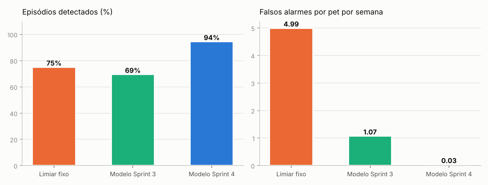
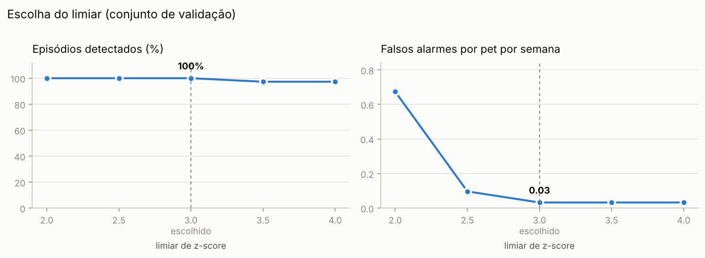
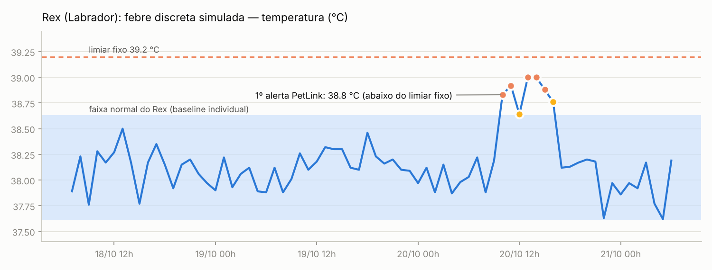

# Resultados da avaliação do modelo de IA

> Gerado automaticamente por `python -m avaliacao.avaliar_modelo` em 29/10/2026 11:48. Dados **sintéticos** (ver `simulador/modelo_fisiologico.py`).

## Protocolo

- 3 pets (Rex, Luna, Bolinha) × 90 dias × 1 leitura/hora = 6480 leituras por conjunto.
- Episódios clínicos injetados aleatoriamente a cada 4–8 dias: `declinio_gradual`, `febre`, `febre_leve`, `hipotermia`, `letargia`, `taquicardia`.
- **Validação (seed 1)** → escolha do limiar de z-score. **Teste (seed 2)** → números abaixo (nunca usado para ajuste).
- Primeira semana descartada para todos os métodos (baseline em formação).
- As 6 h logo após cada episódio são uma janela de tolerância (recuperação do pet): não contam como acerto nem como falso alarme, para nenhum método.

## Resultado no conjunto de teste

| Métrica | Limiar fixo | Modelo Sprint 3 | **Modelo Sprint 4** |
|---|---|---|---|
| Episódios detectados | 75% de 36 | 69% de 36 | **94% de 36** |
| Latência mediana até o 1º alerta | 1 h | 1 h | **2 h** |
| Falsos alarmes / pet / semana | 4.99 | 1.07 | **0.03** |
| Precisão (por leitura) | 54% | 87% | **100%** |
| Recall (por leitura) | 33% | 32% | **44%** |
| F1 (por leitura) | 0.41 | 0.47 | **0.61** |

### Detecção por tipo de episódio

| Episódio | Limiar fixo | Sprint 3 | **Sprint 4** |
|---|---|---|---|
| `declinio_gradual` — Piora lenta ao longo de 3 dias (ex.: doença crônica em início) | 5/7 | 7/7 | **7/7** |
| `febre` — Quadro febril com prostração (ex.: infecção) | 6/6 | 6/6 | **6/6** |
| `febre_leve` — Febre discreta (+0,7 °C) sem outros sinais | 7/11 | 11/11 | **9/11** |
| `hipotermia` — Hipotermia (temperatura < 36,5 °C), sinal de alerta clínico | 3/3 | 0/3 | **3/3** |
| `letargia` — Prostração/dor sem febre (ex.: pós-vacina, dor articular) | 4/5 | 0/5 | **5/5** |
| `taquicardia` — Frequência cardíaca elevada em repouso (ex.: dor, ansiedade, cardiopatia) | 2/4 | 1/4 | **4/4** |

### Por pet (o efeito da individualização)

| Pet | Normal individual | Falsos alarmes/semana — limiar fixo | Sprint 3 | **Sprint 4** | Episódios detectados — limiar fixo | Sprint 3 | **Sprint 4** |
|---|---|---|---|---|---|---|---|
| Rex (Labrador) | 38.10 °C | 0.20 | 0.89 | **0.10** | 4/12 | 9/12 | **11/12** |
| Luna (Siamês) | 38.70 °C | 5.74 | 1.13 | **0.00** | 10/11 | 8/11 | **11/11** |
| Bolinha (Poodle) | 38.95 °C | 9.11 | 1.20 | **0.00** | 13/13 | 8/13 | **12/13** |

> O recall **por leitura** é naturalmente menor que o por episódio: no `declinio_gradual` (72 h) as primeiras horas são quase indistinguíveis do normal, e o objetivo é alertar *durante* o episódio, não em todas as horas dele.

## Escolha do limiar (validação)

| z | Episódios detectados | Falsos alarmes / pet / semana | Latência mediana |
|---|---|---|---|
| 2.0 | 100% | 0.67 | 1 h |
| 2.5 | 100% | 0.10 | 1 h |
| 3.0 ← escolhido | 100% | 0.03 | 1 h |
| 3.5 | 97% | 0.03 | 1 h |
| 4.0 | 97% | 0.03 | 1 h |

## Exemplo: por que baseline individual?

O Rex tem temperatura normal mais baixa que a média da espécie. Uma febre de ~39 °C nele está **abaixo** do limiar fixo de 39,2 °C — a regra clássica não dispara, o PetLink sim. Já a Bolinha tem o normal perto de 39 °C, e o limiar fixo dispara alarmes falsos com frequência.

## Limitações

- Dados sintéticos: os parâmetros fisiológicos são plausíveis, mas não substituem validação com dados clínicos reais.
- A temperatura da coleira é de superfície; em produção ela precisa ser calibrada contra a temperatura retal.
- O modelo sinaliza desvios; **não faz diagnóstico** — a decisão clínica é sempre do veterinário.
